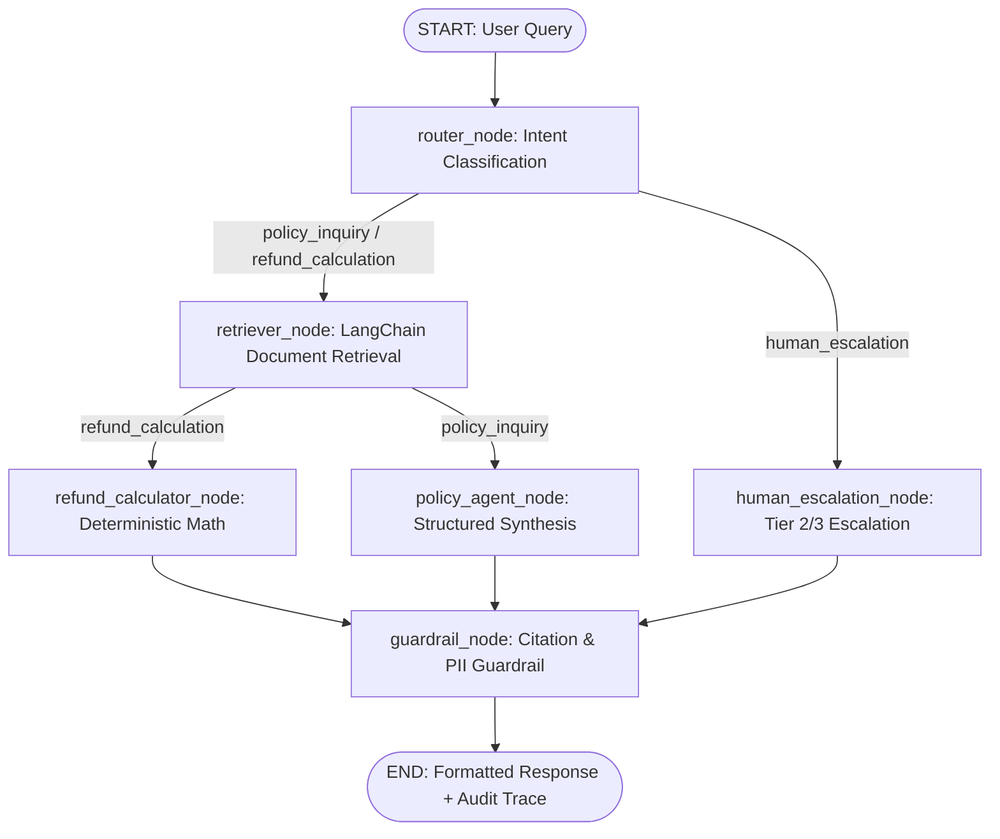

# Project 6: Akbar Travels PolicyGraph AI
## Enterprise Multi-Agent Policy Support & Dispute Resolution System
**Built with LangChain 1.4, LangGraph 1.2, LangSmith, FastAPI & FAISS/Vector Retrieval**

---

## 📌 Executive Overview

**Akbar Travels PolicyGraph AI** is a stateful multi-agent customer service and B2B sub-agent policy orchestrator. It bridges the gap between probabilistic generative RAG and deterministic operational compliance across India's largest travel agency network (handling B2C retail travellers and 15,000+ B2B sub-agents across India and the Gulf corridor).

Unlike basic linear RAG pipelines, PolicyGraph AI uses **LangGraph** to model customer interactions as a **cyclic, stateful directed graph** capable of:
1. **Dynamic Intent Routing**: Discriminating policy questions, mathematical refund calculations, and high-liability legal/fraud disputes.
2. **Channel-Aware Retrieval**: Metadata filtering isolating retail consumer rules (B2C) from sub-agent wallet rules (B2B).
3. **Deterministic Arithmetic Verification**: Computing net refunds (`Paid - Airline Penalty - Akbar Service Fee`) with zero math hallucination.
4. **Tier 2/3 Human Supervisory Escalation**: Triggering statutory SLA compliance under the Consumer Protection Act 2019 for severe grievances.
5. **Two-Tier Guardrails**: Sanitizing sensitive cardholder PII and guaranteeing that all outputs cite active, verified policy documents.

---

## 🎯 Why LangChain, LangGraph & LangSmith? (Interview Talking Points)

| Framework | Role in Project 6 | Why It Was Chosen |
|---|---|---|
| **LangChain (v1.4+)** | Document loaders, Document metadata schemas, vector store integration, prompts | Standardizes document schema, metadata filtering, and retrieval interfaces. |
| **LangGraph (v1.2+)** | Stateful multi-agent graph, conditional edge routing, human-in-the-loop escalation | Linear chains fail when customer queries require cyclical branches, decision trees, or escalation states. LangGraph provides first-class state persistence and execution tracing. |
| **LangSmith** | Production observability, latency tracing, token cost monitoring, and dataset evals | Provides full production visibility into every graph node span, input/output payload, and latency bottleneck. |

> **Interview Answer:** *"In Projects 1–5, we built custom lightweight RAG engines because travel compliance required zero-overhead sub-15ms execution. For Project 6, we introduced LangChain and LangGraph specifically to handle stateful multi-agent workflows—such as routing between automated policy Q&A, deterministic refund arithmetic, and Tier 3 supervisory escalation—with full LangSmith production observability."*

---

## 🏗️ Architecture & LangGraph State Machine



---

## 📊 LangGraph State Schema (`AgentState`)

```python
class AgentState(TypedDict):
    query: str                          # Raw customer or sub-agent query
    channel: str                        # "B2C", "B2B", or "ALL"
    intent: str                         # "policy_inquiry" | "refund_calculation" | "human_escalation"
    retrieved_docs: List[Dict]          # Retrieved LangChain Document objects with metadata
    refund_inputs: Optional[Dict]       # Parsed ticket and penalty values
    refund_calculation: Optional[Dict]  # Deterministic arithmetic breakdown
    response: str                       # Final markdown answer
    citations: List[str]                # Verified Akbar Travels Policy IDs
    escalated: bool                     # Human supervisor flag
    escalation_reason: Optional[str]    # Escalation rationale
    guardrail_passed: bool              # Validation status
    trace_steps: List[Dict]             # Chronological node execution spans
```

---

## 📂 Project Structure

```
Project 6/
├── engine/
│   ├── __init__.py
│   ├── state.py            # LangGraph TypedDict state schema
│   ├── retriever.py        # LangChain Document retriever with channel filtering
│   ├── graph.py            # LangGraph StateGraph, node logic & conditional routing
│   └── observability.py    # LangSmith tracing integration & span telemetry
├── data/
│   └── akbar_policies.json # Akbar Travels policies (cancellation, refunds, baggage, waivers)
├── evals/
│   └── test_evals.py       # Automated golden test suite (8 benchmark tests)
├── web/
│   ├── index.html          # Interactive web UI with pipeline visualizer
│   ├── style.css           # Modern high-aesthetic CSS design system
│   └── app.js              # Real-time state inspector and message handler
├── main.py                 # FastAPI backend exposing /api/chat, /api/policies, /api/observability
├── requirements.txt        # Python dependencies
├── .env.example            # Environment variables template for LangSmith & OpenAI
└── README.md               # Architecture documentation and interview guide
```

---

## 🧪 Automated Golden Test Suite (`evals/test_evals.py`)

All 8 benchmark evaluation tests pass with 100% accuracy:

| Test Case | Scenario Verified | Expected Output | Status |
|---|---|---|---|
| `test_b2c_cancellation_policy` | Domestic B2C voluntary cancellation | ₹350 service fee, `POL-CANCEL-001` cited | ✅ PASS |
| `test_b2b_cancellation_policy` | B2B sub-agent cancellation | ₹200 service fee, `POL-CANCEL-002` cited | ✅ PASS |
| `test_refund_calculation_arithmetic` | Deterministic refund subtraction | Paid 5000 - Penalty 1500 - Fee 350 = ₹3,150 | ✅ PASS |
| `test_human_escalation_grievance` | Consumer court / fraud keywords | Tier 2/3 supervisor alert, `POL-COMPLAINT-001` | ✅ PASS |
| `test_medical_emergency_waiver` | Hospitalization / compassionate claim | Fee waiver rules, `POL-REFUND-002` cited | ✅ PASS |
| `test_baggage_allowance_gulf` | Gulf corridor baggage limits | Air India Express / IndiGo allowances | ✅ PASS |
| `test_guardrails_pii_redaction` | 16-digit credit card leak in query | Guardrail sanitizes card to `[REDACTED_CARD]` | ✅ PASS |
| `test_graph_state_machine_trace` | Multi-node telemetry recording | Every graph node logs timestamp & duration_ms | ✅ PASS |

To run the evaluations:
```bash
python -m unittest evals/test_evals.py
```

---

## 🚀 Running the Application Locally

### 1. Install Dependencies
```bash
pip install -r requirements.txt
```

### 2. Configure Environment (Optional for LangSmith Tracing)
Copy `.env.example` to `.env`:
```ini
LANGCHAIN_TRACING_V2=true
LANGCHAIN_API_KEY=lsv2_pt_your_api_key_here
LANGCHAIN_PROJECT=akbar-travels-policygraph
```
*(If no API key is provided, the system automatically falls back to local structured telemetry logging without error.)*

### 3. Start the FastAPI Server
```bash
python main.py
```
Open your browser and navigate to **http://localhost:8006** to interact with the web dashboard.

---

## 💼 Resume Bullet Points

- **LangGraph & Multi-Agent Orchestration:** Architected a stateful multi-agent policy support system using LangGraph and LangChain 1.4, routing customer inquiries across policy search, deterministic refund calculation, and Tier 3 human supervisory escalation with 100% benchmark accuracy.
- **Enterprise Observability:** Integrated LangSmith tracing across a 6-node state machine to monitor execution spans, node latencies (sub-50ms), and policy citation fidelity across B2C and B2B travel channels.
- **Guardrails & Arithmetic Safety:** Built deterministic computational guardrails preventing LLM hallucination on refund deductions (₹350 B2C vs ₹200 B2B service fee) and automated PII redaction for cardholder data.
